# Run Earth

> MVP 완료 · 스토어 미출시

달린 거리를 누적해 서울에서 부에노스아이레스까지 "**지구 한 바퀴 여정**"을 진행하는 러닝 습관화 앱.
1인 개발 · Flutter + Supabase. 기기 DB를 1차 저장소로 두는 **local-first** 설계로
"**기록은 절대 잃지 않는다**"를 핵심 원칙으로 삼았다.

| Journey | Stack | Scope |
|:-:|:-:|:-:|
| **22 cities** · 19,432km | **Flutter + Supabase** · 별도 서버 없음 | **20 features** · MVP 완료 |

## 실제 화면

|  | 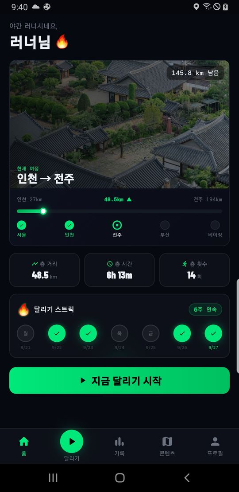 | 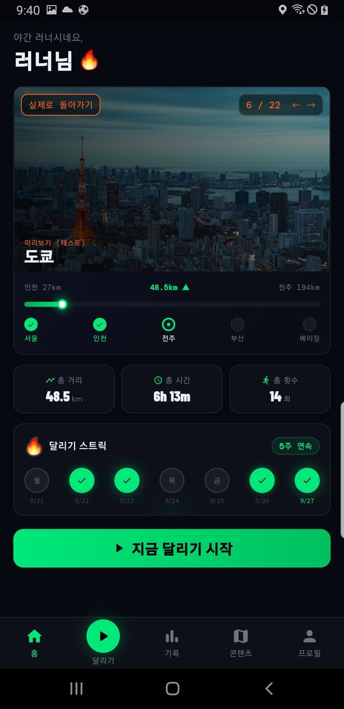 | 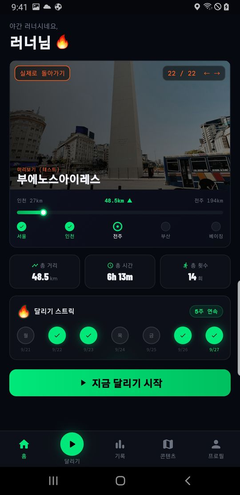 |
|:-:|:-:|:-:|:-:|
| 구글 로그인 | 홈 · 여정 진행도 | 도시 미리보기 · 도쿄 | 도시 미리보기 · 부에노스아이레스 |
| 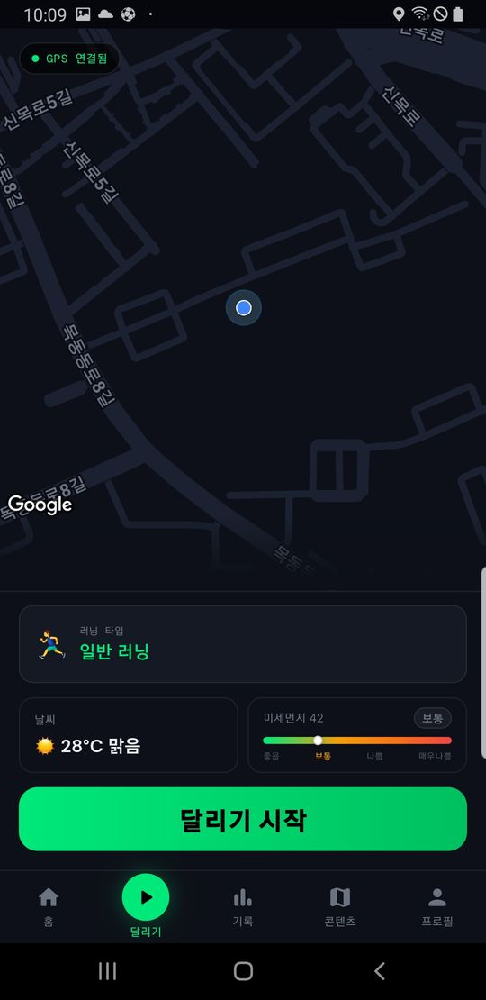 | 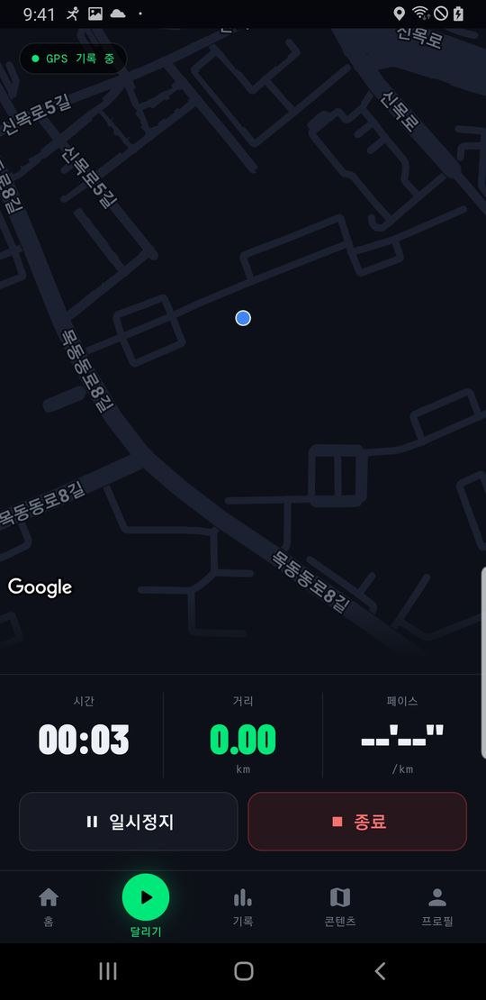 |  | 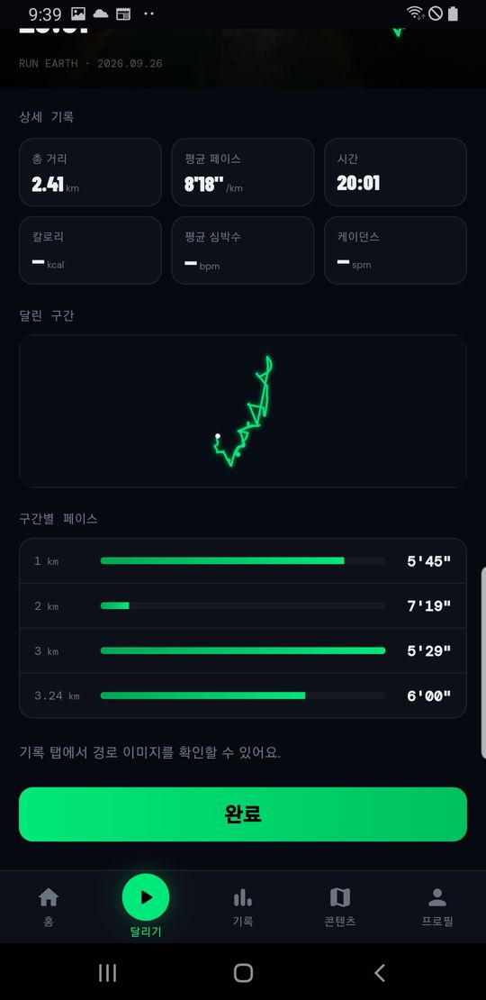 |
| 출발 전 확인 | 실시간 경로 추적 | 사진 위 기록과 경로 | 1km 구간별 페이스 |
| 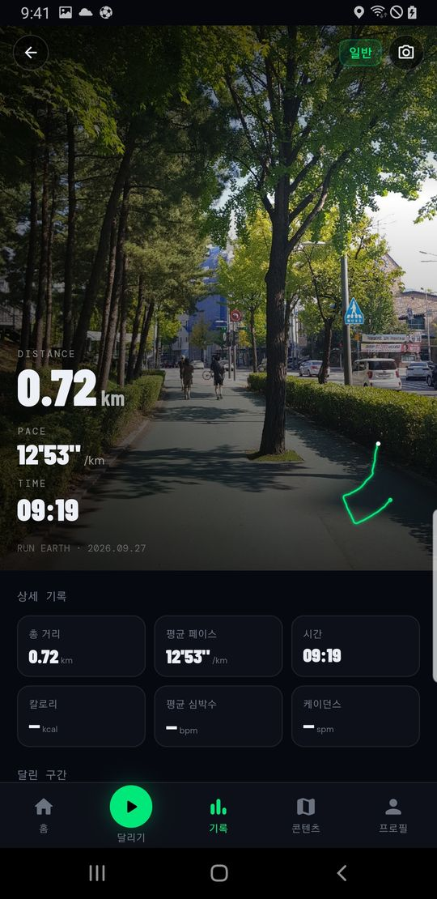 | 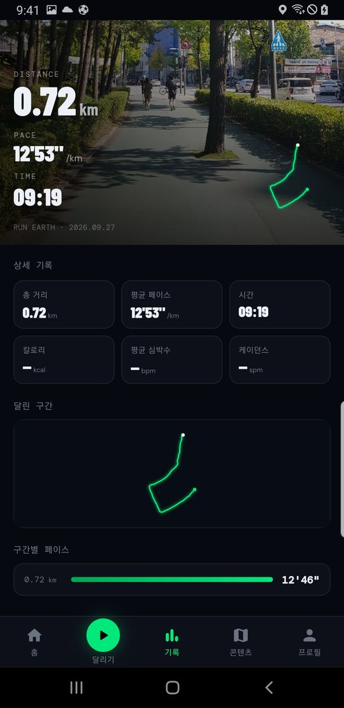 | 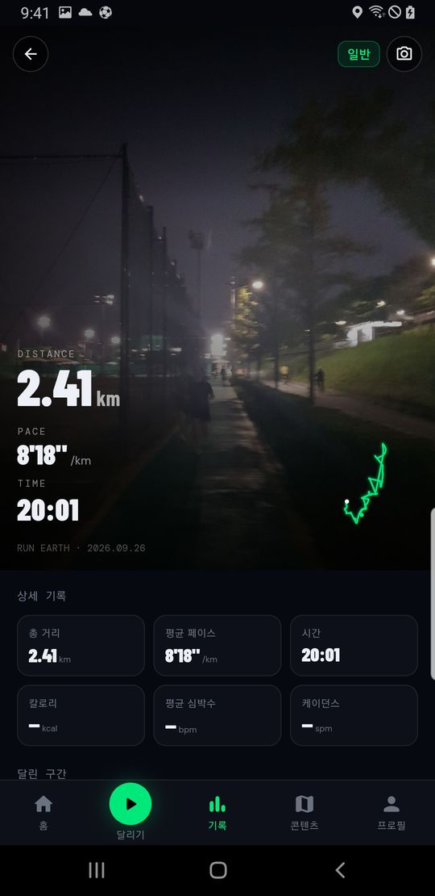 | 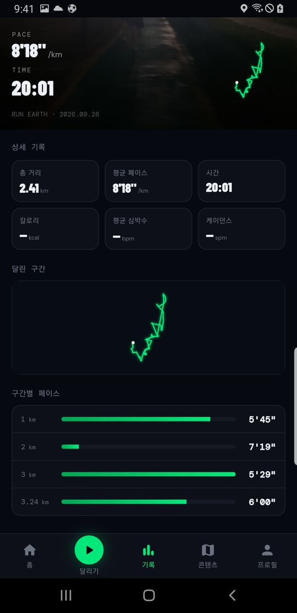 |
| 기록 상세 · 낮 | 기록 상세 · 낮 (구간) | 기록 상세 · 밤 | 기록 상세 · 밤 (구간) |
| 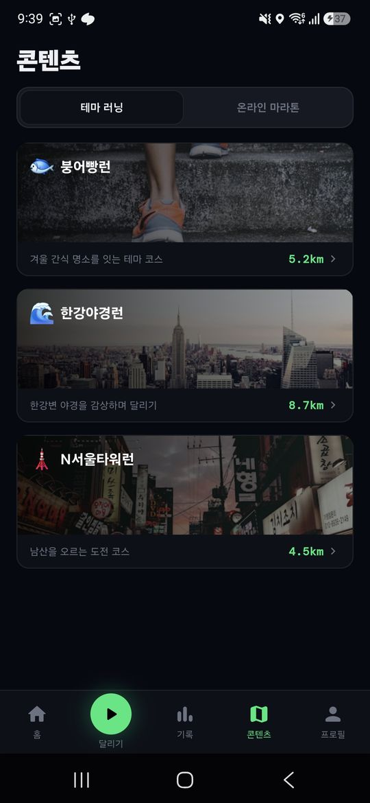 |  |  | 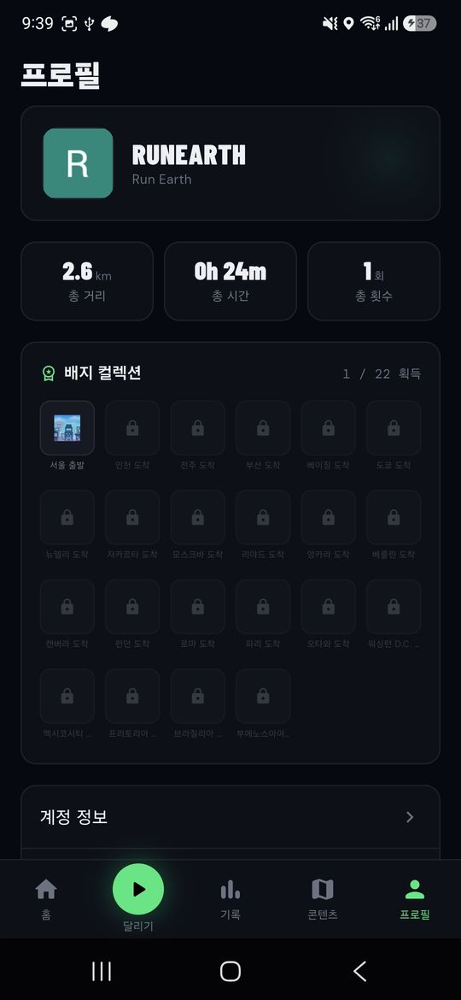 |
| 테마 러닝 코스 | 코스 상세 · 붕어빵런 | 온라인 마라톤 (샘플 값) | 도시 배지 22종 |

## 핵심 설계

- **Local-first** — 기기 DB(drift)가 1차 저장소, 서버는 연결될 때 무제한 재시도로 동기화.
  오프라인에서도 기록이 남고, 새 기기·재설치 시 복원된다.
- **끊기지 않는 GPS 추적** — 화면이 꺼져도 포그라운드 서비스로 추적하고, 강제 종료 시 10초 스냅샷으로 복원.
  야외 실측으로 GPS 노이즈(거리 35% 과대 측정)를 잡아냈다.
- **서버 없는 백엔드** — Supabase Auth · Postgres + RLS · Storage, 예약 작업은 pg_cron → Edge Function.

## 기술 스택

Flutter · Riverpod · go_router · drift (SQLite) · Google Maps · Supabase · 기상청 · 에어코리아 API

> 의사결정과 검증 과정 등 자세한 내용은 [포트폴리오 페이지](https://sonjangwon.github.io/run-earth.html) 참고.

- 앱 코드: [`run_earth/`](run_earth/)

---

## 문서 = 단일 출처

- 기능 작업 전 [`docs/features/{기능}.md`](docs/features/) 를 먼저 읽는다.
- 전체 현황은 [`docs/feature-backlog.md`](docs/feature-backlog.md)
- 세션별 작업 기록·미해결 문제는 [`docs/dev-notes/`](docs/dev-notes/) — **최신 노트부터 읽으면
  지금 어디까지 왔는지 파악된다.**
- 서버 스키마 SQL 은 [`supabase/migrations/`](supabase/migrations/) 에 기록만 해둔다
  (CLI 미도입 — 대시보드에서 실행 후 파일도 추가할 것).

## 폴더 구조 (`run_earth/lib/`)

```
lib/
 ├─ main.dart
 ├─ core/        theme · router · models(코드상 정본) · db(drift) · widgets
 ├─ features/    home / run / records / content / profile / auth
 └─ services/    supabase · sync(동기화 큐) · connectivity
```
